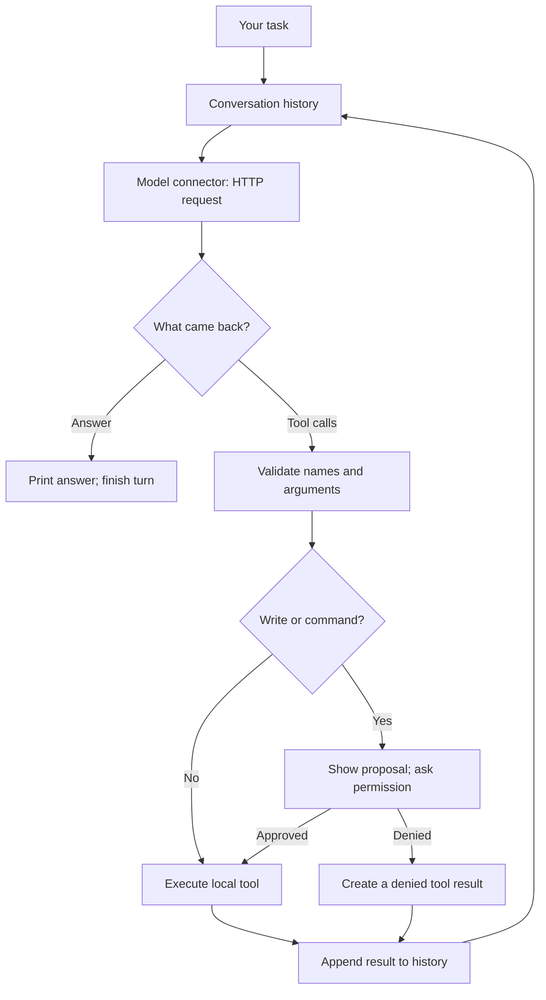

<p align="center">
  
</p>

<h1 align="center">Tinkerloop</h1>

<p align="center">
  <strong>Learn how coding agents work by building the loop.</strong>
</p>

<p align="center">
  <a href="https://github.com/garyamorris/tinkerloop/actions/workflows/ci.yml"></a>
  <a href="LICENSE"></a>
</p>

A coding agent is a loop. Your program sends the conversation to a model. The
model replies with an answer, or with a request to use a tool. Your program runs
the tool, adds the result to the conversation, and asks again.

Tinkerloop is that loop in plain TypeScript: eight short lessons that build it
one piece at a time, and a small command-line agent you can use on real code.
No framework, no runtime dependencies, and you can start without an API key.
It assumes basic TypeScript and no experience building agents.

## The whole idea

```ts
// The heart of src/agent.ts, without its safety checks.
for (let step = 0; step < maxSteps; step++) {
  const reply = await connector.complete({ systemPrompt, messages, tools });
  messages.push(reply.message); // the reply joins the history
  if (reply.message.toolCalls.length === 0) return "complete"; // an answer ends the turn
  for (const call of reply.message.toolCalls) {
    messages.push(await execute(call)); // your code runs the tool, not the model
  }
}
return "limit"; // stop instead of looping forever
```

Everything else in this repository exists to make those lines useful and safe:
connectors that speak each provider's format, tools that stay inside a folder,
approvals before anything changes, and a terminal that shows each step.
The [real loop](src/agent.ts) is under 100 lines.

## Start without an API key

You need Node.js 24 or later.

```sh
git clone https://github.com/garyamorris/tinkerloop.git
cd tinkerloop
npm ci
npm run lesson:1 -- --provider human
```

`--provider human` makes **you** the model. Each request shows exactly what a
model would receive, and you type the reply: an answer, or a tool request such
as `read_file {"path": "sum.js"}`. It is free, works offline, and is the fastest
way to see what the harness does and does not do.

When you have an API key, run `npm run lesson:1` and choose a provider. OpenAI,
Anthropic, Gemini, and any OpenAI-compatible endpoint work in every lesson; see
[provider setup](docs/providers.md). Real API calls may cost money.

## Eight lessons

| Lesson | You add | Run |
| --- | --- | --- |
| [1. Make a model call](lessons/01-model-call/README.md) | One request, one reply | `npm run lesson:1` |
| [2. Remember a conversation](lessons/02-conversation/README.md) | History sent with every request | `npm run lesson:2` |
| [3. Give the model a tool](lessons/03-one-tool/README.md) | One tool request and its result | `npm run lesson:3` |
| [4. Build the loop](lessons/04-the-loop/README.md) | Repeat until the model answers | `npm run lesson:4` |
| [5. Ask before changing files](lessons/05-approvals/README.md) | File writes with your approval | `npm run lesson:5` |
| [6. Check work with commands](lessons/06-commands/README.md) | Command output as evidence | `npm run lesson:6` |
| [7. Wrap the loop in a chat](lessons/07-chat/README.md) | An outer loop of your messages | `npm run lesson:7` |
| [8. Read the complete CLI](lessons/08-the-cli/README.md) | Cancellation, errors, and token counts | `npm run lesson:8` |

Each lesson is one short file you can read top to bottom. The
[lesson guide](lessons/README.md) explains the shared startup code, and the
[glossary](docs/glossary.md) defines every term. Pass the same options to any
lesson:

```sh
npm run lesson:3 -- --provider anthropic --model YOUR_MODEL_ID
npm run lesson:4 -- --cwd examples/tiny-project --trace traces
```

## Reading the terminal

The transcript narrates the loop as it runs:

```text
  you
  Fix sum.js and run the tests.

  ↻ request 1/10 · 1 message sent
  ↳ reply · 1 tool call
  → read_file sum.js
  ✓ read_file sum.js · 2 ms
  ↻ request 2/10 · 3 messages sent
  ↳ reply · answer

  model
  The loop skipped the last number.
```

`↻` is one trip around the loop: the harness sends the whole history to the
model. `↳` is what came back. `→` is a tool your code runs, and `✓` its result,
which joins the history before the next `↻`. Text from the model is labelled
`model`, because Tinkerloop only carries it. More in the
[terminal guide](docs/terminal.md).

## Use it on real code

```sh
# Ask one question, or start a chat with no task.
npm run dev -- "Read README.md and explain this project in three sentences."
npm run dev

# Fix a deliberately broken practice project.
npm run dev -- --cwd examples/tiny-project "Read the code, fix sum.js, and run npm test."

# Save the exact JSON sent to and received from the model, one file per request.
npm run dev -- --trace traces "Read package.json and summarize it."
```

The [practice projects](examples/README.md) get harder, and include a
prompt-injection exercise.

**Review each proposed edit and command before typing `y`.** Reads happen
automatically. File tools stay inside the selected workspace and exclude
symlinks, `.git`, `node_modules`, and `.env` files except `.env.example`.
Approved shell commands run with your user account's permissions: **this is not
a sandbox**. Read the [local access explanation](docs/local-access.md) before
using it on a project with sensitive data.

When settings are missing, Tinkerloop asks for a provider and model, and
full-screen mode accepts a hidden API key for that session. Nothing is saved.
To skip the questions, copy `.env.example` to `.env.local`
(`cp .env.example .env.local`, or `Copy-Item .env.example .env.local` in
PowerShell) and edit the copy:

```dotenv
TINKERLOOP_PROVIDER=openai
TINKERLOOP_MODEL=gpt-5.4-mini
OPENAI_API_KEY=replace-with-your-own-key
```

Use a model ID your account can access; only the chosen provider needs a key.
Existing environment variables take precedence over `.env.local`, which is
loaded from the directory you launch from. Keep it private.

## How it works



The model returns structured requests. **Your program executes the tools.**
A failed or denied tool request is also a result, so the model can explain what
happened. Ten model requests per turn is the default limit.

Read the [architecture walkthrough](docs/how-it-works.md) and the
[annotated tool transcript](docs/tool-transcript.md) for a full example.

## Command reference

```sh
npm run build
node dist/cli.js --help

# Optional: register this clone as the tinkerloop command.
npm link
tinkerloop --help
```

This installs from your clone; the project is not published to the npm registry.
Remove the command later with `npm unlink --global tinkerloop`.

| Option | Purpose | Default |
| --- | --- | --- |
| `--provider` | `openai`, `anthropic`, `gemini`, `compatible`, or `human` (you type the replies) | Environment, then prompt; scripts default to `openai` |
| `--model` | Provider's model ID | Environment, then prompt; required for scripts |
| `--cwd` | Directory for local tools | Launch directory |
| `--max-steps` | Maximum model requests per turn | `10` |
| `--context-window` | Optional model token limit, to show a context percentage | `TINKERLOOP_CONTEXT_WINDOW`; otherwise unset |
| `--trace` | Folder for numbered request/response bodies (no headers or keys) | Off |
| `--plain` | Use a scrolling transcript | Full-screen in a capable terminal |
| `--help` | Show help without an API key | — |

In chat, Ctrl+C stops the current turn and keeps the conversation; at the
prompt it quits. Without a terminal, pass a task and configure settings ahead of
time: there are no setup questions, and writes and commands are denied. The
[terminal guide](docs/terminal.md) covers keys, scrolling, colors, pipes, exit
codes, and what each token counter means.

## Find your way around

| Code | Responsibility |
| --- | --- |
| [`src/agent.ts`](src/agent.ts) | The model/tool loop |
| [`src/types.ts`](src/types.ts) | Shared messages, requests, and tool contracts |
| [`src/connectors/`](src/connectors/) | One file per provider's HTTP format; [`human.ts`](src/connectors/human.ts) lets you play the model; [`trace.ts`](src/connectors/trace.ts) saves request bodies |
| [`src/tools.ts`](src/tools.ts), [`src/command.ts`](src/command.ts) | Local file and shell tools |
| [`src/main.ts`](src/main.ts), [`src/terminal.ts`](src/terminal.ts) | Chat and approvals |
| [`src/setup.ts`](src/setup.ts), [`src/config.ts`](src/config.ts) | Guided startup and explicit configuration |
| [`src/display.ts`](src/display.ts), [`src/render.ts`](src/render.ts), [`src/usage.ts`](src/usage.ts) | The transcript, its colours, and token accounting |
| [`src/screen.ts`](src/screen.ts) | Optional full-screen view and keyboard input, using native Node APIs |
| [`lessons/`](lessons/README.md) | Runnable stages with explanations and exercises |
| [`examples/`](examples/README.md) | Practice projects with deliberate bugs, plus a prompt-injection exercise |

Next steps: [add a tool or connector](docs/extending.md),
[troubleshoot setup](docs/troubleshooting.md), or [contribute](CONTRIBUTING.md).
The [changelog](CHANGELOG.md) lists what changed in each version.

## Check your changes

```sh
npm run check
```

This typechecks the application, lessons, and tests; runs tests; and builds the
CLI. Tests use synthetic HTTP responses and temporary workspaces, so they need
no API keys and spend no model tokens. CI runs the checks on macOS, Linux, and
Windows. The practice projects' intentionally failing tests are separate.

Tinkerloop keeps conversations in memory. It does not include streaming, saved
sessions, context compaction, MCP, or background jobs; the
[extension guide](docs/extending.md) turns several of these into exercises. The
goal is code you can understand and change. MIT licensed; see [LICENSE](LICENSE).
