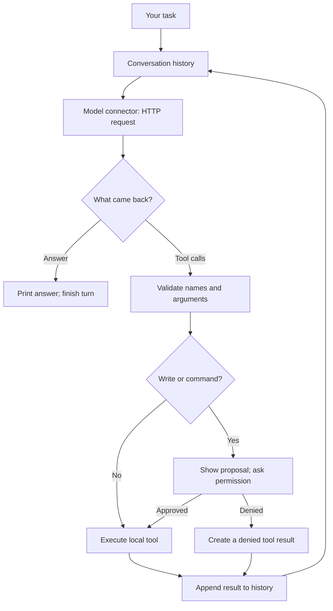

# Tinkerloop

**A tiny coding harness, explained from the ground up.**

[](https://github.com/garyamorris/tinkerloop/actions/workflows/ci.yml)
[](LICENSE)

Build your own coding agent by understanding the pieces: a model connection,
conversation history, tools, an execution loop, and a terminal interface.
Tinkerloop is a working TypeScript CLI and a sequence of five runnable lessons.
It assumes basic TypeScript knowledge and no previous agent-building experience.

There is no agent framework and there are **zero runtime dependencies**. Model
connectors use `fetch`; files, processes, and terminal input use Node's built-in
APIs. The [core loop](src/agent.ts) is small enough to read in one sitting.

The full-screen terminal has a fixed header, scrollable conversation, input line,
and live input/output/cache token counts. It renders basic Markdown and code,
shows tool activity, and asks before changes. `/usage` shows session totals;
`/context` inspects conversation size. [See the terminal guide](docs/terminal.md).

## Try it

You need **Node.js 24+**, npm, and access to a tool-capable model. Real API calls
may cost money. Every lesson supports OpenAI, Anthropic, Gemini, and a configurable
OpenAI-compatible endpoint. See [provider setup](docs/providers.md).

```sh
git clone https://github.com/garyamorris/tinkerloop.git
cd tinkerloop
npm ci
npm run dev
```

**Just run it:** when settings are missing, Tinkerloop asks you to choose a
provider and enter a model ID. Full-screen mode also accepts a hidden API key
for this session. Arrow keys choose, Enter confirms, and Ctrl+C quits. No
settings or keys are saved automatically. The same setup works in every lesson.

To skip those questions on future runs, copy `.env.example` to `.env.local`
(`cp .env.example .env.local` on macOS/Linux, or
`Copy-Item .env.example .env.local` in PowerShell). Edit the copy:

```dotenv
TINKERLOOP_PROVIDER=openai
TINKERLOOP_MODEL=gpt-5.4-mini
OPENAI_API_KEY=replace-with-your-own-key
```

Use a model ID available to your API account. Setup offers `gpt-5.4-mini` as an
OpenAI suggestion; press Enter to accept or type a different ID. Scripts still
require an explicit model. Existing environment variables take precedence over `.env.local`.
Only your chosen provider needs credentials. Keep `.env.local` private.

```sh
# Ask one question. In full-screen mode, press Enter after reviewing the answer.
npm run dev -- "Read README.md and explain this project in three sentences."

# Start a conversation. /usage and /context inspect it; /exit quits.
npm run dev

# Try a real coding task in the deliberately broken practice project.
npm run dev -- --cwd examples/tiny-project "Read the code, fix sum.js, and run npm test."

# Prefer a normal scrolling terminal transcript?
npm run dev -- --plain
```

**Review each proposed edit and command before typing `y`.** Reads happen
automatically. File tools stay inside the selected workspace and exclude
symlinks, `.git`, `node_modules`, and `.env` files except `.env.example`. Approved
shell commands run with your user account's permissions: **this is not a sandbox**.
Read the [local access explanation](docs/local-access.md) before using it on a
project with sensitive data.

## Learn it, one building block at a time

| Lesson | What you add | Run |
| --- | --- | --- |
| [1. A model call](lessons/01-model-call/README.md) | Send a request and inspect a response | `npm run lesson:1` |
| [2. Conversation history](lessons/02-conversation/README.md) | Remember an earlier exchange | `npm run lesson:2` |
| [3. One tool round trip](lessons/03-one-tool/README.md) | Let the model request a local file read | `npm run lesson:3` |
| [4. The execution loop](lessons/04-the-loop/README.md) | Repeat until the model answers | `npm run lesson:4` |
| [5. The complete CLI](lessons/05-the-cli/README.md) | Approvals, edits, commands, and chat | `npm run lesson:5` |

You can pass the same options to every lesson:

```sh
npm run lesson:3 -- --provider anthropic --model YOUR_MODEL_ID "Read package.json."
npm run lesson:4 -- --max-steps 4 --cwd examples/tiny-project
```

Each stage keeps its conversation logic in plain sight. The shared startup and
connector code avoids maintaining four copies of every lesson. Start with the
[lesson guide](lessons/README.md), which explains that shared layer.

## How it works



The model returns structured requests. **Your program executes the tools.**
A failed or denied tool request is also a result, so the model can explain what
happened. Ten model requests per user turn is the default upper bound.

Read the [architecture walkthrough](docs/how-it-works.md) and
[annotated tool transcript](docs/tool-transcript.md) for a full example.

## Use the built command

```sh
npm run build
node dist/cli.js --help
node dist/cli.js --cwd examples/tiny-project "Explain the failing tests."

# Optional: register this local clone as the tinkerloop command.
npm link
tinkerloop --help
```

This installs from your clone; the project is not published to the npm registry.
Remove the local command later with `npm unlink --global tinkerloop`.

| Option | Purpose | Default |
| --- | --- | --- |
| `--provider` | `openai`, `anthropic`, `gemini`, or `compatible` | Environment, then prompt; scripts default to `openai` |
| `--model` | Provider's model ID | Environment, then prompt; required for scripts |
| `--cwd` | Directory for local tools | Launch directory |
| `--max-steps` | Maximum model requests per user turn | `10` |
| `--context-window` | Optional model token limit, to show a context percentage | `TINKERLOOP_CONTEXT_WINDOW`; otherwise unset |
| `--plain` | Use a scrolling transcript | Full-screen in a capable terminal |
| `--help` | Show help without an API key | — |

`.env.local` is loaded from the **launch directory**, not the `--cwd` target.
Full-screen mode uses an alternate terminal screen and restores it on exit.
Use PgUp/PgDn to scroll, and up/down to recall previous input. A quoted task
and lessons 1–4 wait for Enter after finishing, so you can review the result.
`--plain` uses a scrolling transcript and exits immediately after a quoted task.
Without a terminal, configure settings and pass a task; there are no setup
questions, and writes and commands are denied.
Exit codes: `0` for a completed run or normal chat exit, `1` for an error or
incomplete single-task run, and `130` for Ctrl+C cancellation.

Interactive terminals format basic Markdown and wrap prose to their width.
`NO_COLOR` disables colors; `TERM=dumb` uses the scrolling view. Redirected stdout
stays plain model text; branding, progress, and usage stay on stderr. `/clear` forgets the conversation
while retaining usage totals for this process. A dash means the provider did
not report that token metric, rather than zero usage.

## Find your way around

| Code | Responsibility |
| --- | --- |
| [`src/types.ts`](src/types.ts) | Shared messages, requests, and tool contracts |
| [`src/connectors/`](src/connectors/) | Explicit HTTP requests and response translation |
| [`src/agent.ts`](src/agent.ts) | The model/tool loop |
| [`src/tools.ts`](src/tools.ts), [`src/command.ts`](src/command.ts) | Local file and shell tools |
| [`src/main.ts`](src/main.ts), [`src/terminal.ts`](src/terminal.ts) | Chat and human approvals |
| [`src/setup.ts`](src/setup.ts), [`src/config.ts`](src/config.ts) | Guided startup and explicit configuration |
| [`src/screen.ts`](src/screen.ts) | Optional full-screen view and keyboard input, using native Node APIs |
| [`src/display.ts`](src/display.ts), [`src/render.ts`](src/render.ts), [`src/usage.ts`](src/usage.ts) | Terminal presentation and provider-independent token accounting |
| [`lessons/`](lessons/) | Runnable stages with explanations and exercises |

Next steps: [add a tool or connector](docs/extending.md),
[troubleshoot setup](docs/troubleshooting.md), or [contribute](CONTRIBUTING.md).

## Check your changes

```sh
npm run check
```

This typechecks the application, lessons, and tests; runs tests; and builds the
CLI. Tests use synthetic HTTP responses and temporary workspaces, so they need
no API keys and spend no model tokens. CI runs the checks on macOS, Linux, and
Windows. The practice project's intentionally failing tests are separate.

The first version keeps conversations in memory. It does not include streaming,
saved sessions, context compaction, MCP, or background jobs. The goal is code you
can understand and change. MIT licensed; see [LICENSE](LICENSE).
